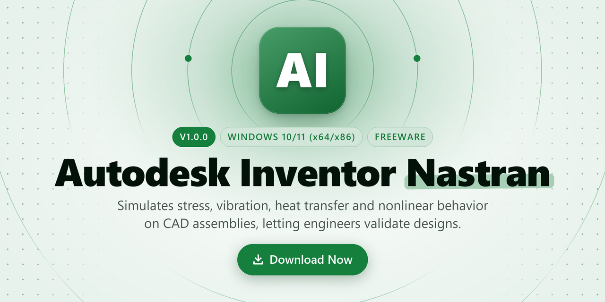

<h1 align="center">Autodesk Inventor Nastran - Finite Element Analysis for Windows 10/11</h1>

<p align="center"><i>A structural, thermal, and vibration simulation environment integrated with Autodesk Inventor for stress, modal, and nonlinear analysis. This page covers system requirements, configuration paths, solver comparison, shortcuts, and CLI automation for analysts and mechanical engineers.</i></p>

<p align="center">&nbsp;&nbsp;&nbsp;&nbsp;&nbsp;&nbsp;&nbsp;&nbsp;</p>

<p align="center"></p>

<p align="center">
  <a href="https://quangshah224.github.io/autodesk-inventor-nastran/">
    <picture>
      <source media="(prefers-color-scheme: dark)" srcset="./assets/Click-dark.svg">
      
    </picture>
  </a>
</p>

## Table of Contents

<p align="center"><a href="#overview">Overview</a> &nbsp;|&nbsp; <a href="#requirements">Requirements</a> &nbsp;|&nbsp; <a href="#key-features">Key Features</a> &nbsp;|&nbsp; <a href="#configuration">Configuration</a> &nbsp;|&nbsp; <a href="#analysis-comparison">Analysis Comparison</a> &nbsp;|&nbsp; <a href="#keyboard-shortcuts">Keyboard Shortcuts</a> &nbsp;|&nbsp; <a href="#command-line-options">Command-Line Options</a> &nbsp;|&nbsp; <a href="#troubleshooting">Troubleshooting</a> &nbsp;|&nbsp; <a href="#faq">FAQ</a> &nbsp;|&nbsp; <a href="#notes">Notes</a></p>

## Overview

Autodesk Inventor Nastran is a finite element analysis solver embedded in the Inventor simulation environment. It reads native assembly geometry, meshes it, and dispatches the model to a local or remote solver for linear and nonlinear studies.

### What It Does

Performs linear static, normal modes, buckling, steady-state and transient heat transfer, nonlinear static, and explicit dynamics studies on Inventor parts and assemblies. Results return as contour plots, probes, and report output inside the same model tree.

### Who It Is For

Mechanical design engineers and FEA analysts responsible for validating parts, weldments, and assembled mechanisms before fabrication. It is also used by simulation specialists who script batch runs against Inventor assemblies via the Nastran command interface.

### What Ships in the Build

The installation bundles the Inventor add-in, the Nastran solver executable, the Autodesk Nastran Editor for post-processing, material libraries, and a set of sample models. A network license server component is included for multi-seat deployments.

## Requirements

| Spec | Minimum | Recommended |
|---|---|---|
| OS | Windows 10 64-bit (build 1809) | Windows 11 64-bit (23H2 or later) |
| CPU | 4-core x86-64, SSE4.2 | 8-core or higher with AVX2 |
| RAM | 16 GB | 32 GB or more for assemblies over 500 parts |
| GPU or display | DirectX 11, 1920x1080 | DirectX 12, 2560x1440, certified Quadro or Radeon Pro |
| Storage | 40 GB free on system drive | NVMe SSD with 80 GB free for scratch and results |
| Solver scratch space | 10 GB local temp | Dedicated scratch disk sized to 5x model size |

## Key Features

* **Embedded FEA Environment** , runs all studies from the Inventor ribbon without exporting geometry.
* **Nonlinear Contact** , detects and resolves bonded, sliding, and separating contacts between assembly components.
* **Frequency Response** , computes steady-state harmonic response across a user-defined frequency sweep.
* **Thermal Coupling** , imports thermal results as a load into subsequent structural studies.
* **Remote Solver Dispatch** , offloads solve jobs to a configured Nastran server or cloud endpoint.
* **Autodesk Nastran Editor** , opens .nas and .fno deck and results files for direct editing and inspection.
* **Batch Automation** , drives solves from a scripted command line without opening the GUI.
* **Material Library Sync** , pulls material properties from Autodesk materials and custom XML libraries.

## Configuration

| Path | Purpose |
|---|---|
| `%APPDATA%\Autodesk\Inventor Nastran 2024\` | Per-user settings, ribbon customization, and recent file list |
| `%LOCALAPPDATA%\Autodesk\Inventor Nastran 2024\Temp\` | Working scratch directory for mesh and solver intermediate files |
| `%PROGRAMDATA%\Autodesk\Inventor Nastran 2024\Materials\` | Shared material library XML available to all users |
| `%PROGRAMDATA%\Autodesk\Nastran 2024\` | Solver configuration, license server details, remote host list |
| `%APPDATA%\Autodesk\Autodesk Nastran Editor 2024\` | Editor preferences, deck templates, and post-processing macros |
| `%USERPROFILE%\Documents\Inventor Nastran\` | Default output location for study results and HTML reports |

| Setting | Default | Notes |
|---|---|---|
| Solver execution location | Local | Switchable to remote host or cloud in solver settings |
| Default iteration limit | 100 | Raise for nonlinear studies with slow convergence |
| Unit system | Follows Inventor doc | Override per-study in the analysis dialog |
| Mesh size scale | 0.5 | Controls global element size relative to feature size |
| Result output format | .fno | Change to .op2 for external post-processors |
| Update channel | Stable | Selectable in Autodesk desktop app preferences |
| Log verbosity | Info | Set to Debug to capture full solver stdin and stdout |

## Analysis Comparison

| Study Type | Typical Solve Time (relative) | Memory Profile | Nonlinear Support | Best For |
|---|---|---|---|---|
| Linear Static | 1x baseline | Low | No | Stiffness and stress checks on rigid parts |
| Normal Modes | 2x baseline | Medium | No | Natural frequency and modal assurance |
| Buckling | 1.5x baseline | Low | No | Critical load factors on slender members |
| Nonlinear Static | 8x baseline | High | Yes | Contact, plasticity, and large deflection |
| Steady-State Heat Transfer | 1.5x baseline | Low | No | Thermal gradients feeding structural loads |

## Keyboard Shortcuts

| Action | Shortcut |
|---|---|
| Run current study | Ctrl+Shift+R |
| Create new analysis | Ctrl+Alt+N |
| Open Nastran Editor for active study | Ctrl+Alt+E |
| Toggle mesh visibility | Shift+M |
| Show results contour plot | F6 |
| Probe result at cursor | P |
| Export results to report | Ctrl+Shift+E |
| Copy active study settings to clipboard | Ctrl+Alt+C |
| Open solver settings dialog | Ctrl+Alt+S |
| Fit model to view | Home |

## Command-Line Options

| Flag | Argument | Purpose |
|---|---|---|
| `-i` | input deck path | Specifies the Nastran input file (.nas) to run |
| `-o` | output basename | Sets the prefix for result and log files |
| `-n` | integer | Sets the number of parallel solver threads |
| `-memory` | GB value | Allocates memory ceiling for the solve |
| `-scratch` | directory path | Overrides the scratch directory location |
| `-lic` | server or cloud | Points the solver at a license host |
| `-batch` | none | Runs in headless mode without UI dialogs |
| `-restart` | study identifier | Resumes a previously interrupted solve |

```bash
NastranSolver.exe -i "C:\models\bracket.nas" -o "C:\results\bracket" -n 8 -memory 24 -batch
```

| Exit Code | Meaning |
|---|---|
| 0 | Solve completed and results written |
| 1 | Input deck parse error |
| 2 | License checkout failed |
| 3 | Solver diverged or iteration limit reached |
| 4 | Scratch directory allocation error |

## Troubleshooting

### Solver reports license checkout failure

The solve aborts with exit code 2 and the log shows no available license token, typically after a network interruption or expired license lease.

1. Confirm `Autodesk Network License Manager` service is running on the license host.
2. Run `lmutil lmstat -a -c @licensehost` to verify seat availability.
3. Set the `ADSKFLEX_LICENSE_FILE` environment variable to the correct server.
4. Reopen Inventor and retry the study; if it persists, restart the FlexNet service on the host.

### Mesh generation stalls on large assemblies

Mesh generation hangs at a low percentage and the progress bar does not advance, often on assemblies exceeding 500 parts.

1. Increase the local scratch disk free space to at least 5x the assembly file size.
2. Set the mesh size scale to 0.8 as a test to reduce element count.
3. Split the assembly into subassemblies and mesh each separately.
4. Move scratch to an NVMe drive and re-run.

### Results contour plot renders blank

The study completes but the result view shows no contour bands, usually after a GPU driver update.

1. In Inventor, navigate to Tools > Application Options > Display and disable hardware acceleration.
2. Update the certified Quadro or Radeon Pro driver from the vendor site.
3. Clear the `%LOCALAPPDATA%\Autodesk\Inventor Nastran 2024\Temp\` directory.
4. Reload the results with F6 and verify the active result set is selected.

### Nonlinear study diverges before iteration limit

The solver exits with code 3 on nonlinear studies with contact, reporting huge displacement increments.

1. Lower the initial load increment in the nonlinear setup dialog.
2. Enable automatic load stepping and set maximum cutbacks to 20.
3. Add a soft spring constraint to stabilize free bodies before contact engagement.
4. Check contact stiffness scale and reduce it by a factor of 10.

## FAQ

### Can I run Inventor Nastran studies without opening Inventor?

Yes, the Nastran solver binary accepts a `.nas` deck and runs headless with `-batch`. Deck export requires an initial GUI session to generate, but subsequent runs and restarts do not open the Inventor interface.

### Does the solver use all available CPU cores by default?

It defaults to the physical core count detected at launch, capped at the license entitlement. Override with the `-n` flag or in the solver settings dialog if you need to reserve cores for other work.

### Can results be opened in third-party post-processors?

Yes, change the result output format to `.op2` in study settings to write a format readable by Patran, HyperView, and other Nastran-compatible post-processors. The default `.fno` format is read natively by the Autodesk Nastran Editor.

## Notes

Autodesk, Inventor, and Nastran are trademarks of Autodesk, Inc. This documentation describes installation and usage behavior on Windows 10 and 11; feature availability and file paths may differ across release years and license tiers.